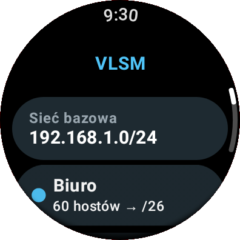
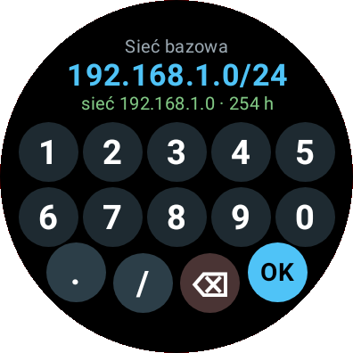
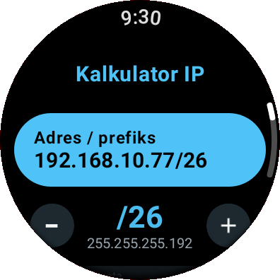

# VLSM na Wear OS ⌚

Natywna aplikacja (Kotlin + Jetpack Compose for Wear OS) do liczenia sieci **VLSM** i innych
obliczeń IPv4 – zaprojektowana pod **Samsung Galaxy Watch 4 Classic** (okrągły ekran, obrotowy bezel).
Działa samodzielnie, bez telefonu i bez internetu.

| Menu | VLSM | Liczba hostów (bezel) | Wynik |
|---|---|---|---|
|  |  |  |  |
| **Klawiatura IP** | **Kalkulator IP** | **FLSM** | **Sumaryzacja** |
|  |  |  |  |

## Funkcje

- **Kalkulator VLSM** – sieć bazowa + lista podsieci (nazwa, liczba hostów):
  - przydział od największej podsieci (lub w kolejności wpisania, z poprawnym wyrównaniem),
  - dla każdej podsieci: adres sieci, prefiks, maska, zakres hostów, broadcast, zapas,
  - kolorowy pasek wykorzystania przestrzeni adresowej, % zajętości i efektywność,
  - lista **wolnych bloków** pozostałych po przydziale,
  - gdy się nie mieści: ile adresów brakuje i przycisk „Użyj /X” (powiększa sieć),
  - opcja **/31 i /32** dla łączy punkt-punkt (RFC 3021),
  - podgląd na żywo przed obliczeniem („Zajmie 152/256 adr.”).
- **Kalkulator IP** – sieć, maska, wildcard, pierwszy/ostatni host, broadcast, liczba hostów,
  klasa, typ adresu (prywatny, publiczny, CGNAT, loopback, link-local, multicast…), poprzednia
  i następna sieć, zapis binarny z granicą prefiksu, hex, strefa odwrotnego DNS; szybka zmiana prefiksu −/+.
- **Podział równy (FLSM)** – według liczby podsieci, liczby hostów albo nowego prefiksu.
- **Sumaryzacja tras** – trasa sumaryczna (supernet) + dokładna agregacja i liczba „nadmiarowych” adresów.
- **Ta sama sieć?** – czy dwa adresy są w jednej podsieci, wspólna nadsieć, ostrzeżenia
  (adres sieci / broadcast).
- **Ile hostów → prefiks** – liczba hostów bezelem, od razu prefiks, maska, rozmiar bloku i zapas.
- **Tabela masek** /0–/32 (dotknięcie otwiera kalkulator IP z danym prefiksem).
- **Zapisane projekty** – zapis, wczytywanie, zmiana nazwy, usuwanie. Cały stan zapisuje się automatycznie.

## Sterowanie

- **Bezel** przewija listy i zmienia liczbę hostów (szybki obrót = skok o 10/100), z wibracją przy każdym kroku.
- **Klawiatura** dopasowana do okrągłego ekranu: sama wstawia kropki (po 3 cyfrach, po „0”,
  gdy oktet przekroczyłby 255) i ukośnik po pełnym adresie. Przytrzymaj ⌫, aby wyczyścić.
  Akceptuje `10.0.0.0/8`, `10.0.0.0/255.0.0.0` lub sam adres (maska klasowa).
- **Przesunięcie w prawo** – powrót. Dotknięcie nazwy podsieci – zmiana nazwy (klawiatura lub głos).

## Instalacja na Galaxy Watch 4 Classic

Gotowy plik APK: zakładka **Actions** → ostatni build → artefakt `vlsm-wear-apk`
(albo zbuduj sam – patrz niżej).

1. Na zegarku: **Ustawienia → Informacje o zegarku → Oprogramowanie** → 7× dotknij
   „Wersja oprogramowania”, aby włączyć opcje programisty.
2. **Ustawienia → Opcje programisty**: włącz **Debugowanie ADB** i **Debugowanie bezprzewodowe**
   (zegarek i komputer w tej samej sieci Wi-Fi).
3. W „Debugowanie bezprzewodowe” wybierz **Paruj nowe urządzenie** i na komputerze:
   ```bash
   adb pair IP_ZEGARKA:PORT_PAROWANIA
   ```
   (wpisz kod z zegarka), a potem:
   ```bash
   adb connect IP_ZEGARKA:PORT
   ```
4. Zainstaluj:
   ```bash
   adb install -r app-release.apk
   ```
5. Aplikacja **VLSM** pojawi się na liście aplikacji zegarka.

## Budowanie

Wymagania: JDK 17+, Android SDK (platforma 35).

```bash
./gradlew :app:assembleRelease      # APK: app/build/outputs/apk/release/app-release.apk
./gradlew :app:testDebugUnitTest    # testy logiki + renderowanie wszystkich ekranów (Robolectric)
```

Zrzuty ekranów z testów trafiają do `app/build/screenshots/`.

## Struktura

```
app/src/main/java/pl/vlsmcalc/wear/
├── core/         # czysta logika IPv4: Ip, Cidr, VLSM, FLSM, sumaryzacja (bez zależności od Androida)
├── data/         # zapis stanu i projektów (SharedPreferences/JSON)
└── ui/           # ekrany Compose for Wear OS, klawiatura, stepper z bezelem, nawigacja
```

Min. Wear OS 3 (API 30) – Galaxy Watch 4 i nowsze.
