# VLSM + NetTools + CCNA na Wear OS ⌚

Trzy natywne aplikacje na zegarek (Galaxy Watch 4 Classic i nowsze):

- **VLSM** – kalkulator podsieci (opis poniżej),
- **NetTools** – ściąga komend Cisco IOS po polsku + narzędzia sieciowe ([opis](#nettools)),
- **CCNA** – nauka do egzaminu CCNA 200-301: teoria, fiszki, quizy, egzaminy próbne ([opis](#ccna)).


Natywna aplikacja (Kotlin + Jetpack Compose for Wear OS) do liczenia sieci **VLSM** i innych
obliczeń IPv4 – zaprojektowana pod **Samsung Galaxy Watch 4 Classic** (okrągły ekran, obrotowy bezel).
Działa samodzielnie, bez telefonu i bez internetu.

| Menu | VLSM | Liczba hostów (bezel) | Wynik |
|---|---|---|---|
| 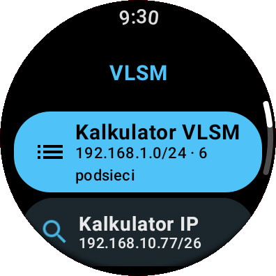 |  | 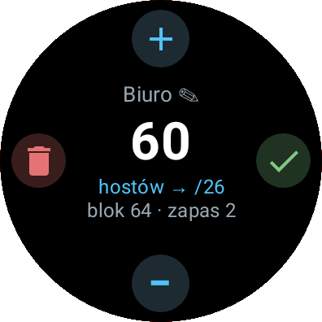 | 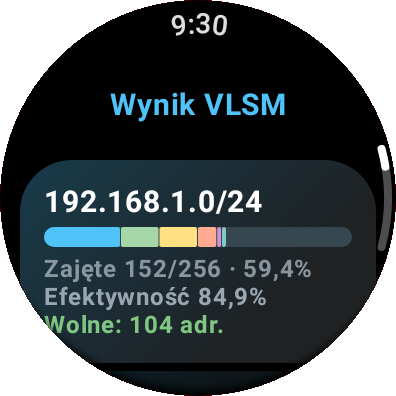 |
| **Klawiatura IP** | **Kalkulator IP** | **FLSM** | **Sumaryzacja** |
|  |  | 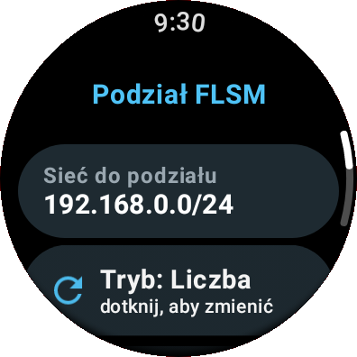 | 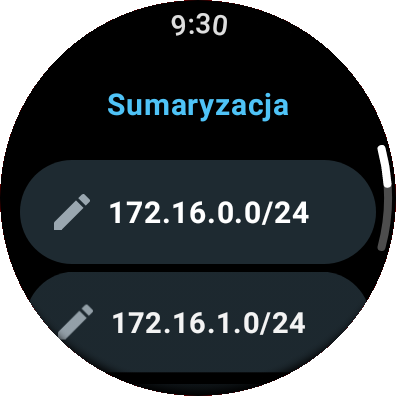 |

## Funkcje

- **Kalkulator VLSM** – sieć bazowa + lista podsieci (nazwa, liczba hostów):
  - przydział od największej podsieci (lub w kolejności wpisania, z poprawnym wyrównaniem),
  - dla każdej podsieci: adres sieci, prefiks, maska, zakres hostów, broadcast, zapas,
  - kolorowy pasek wykorzystania przestrzeni adresowej, % zajętości i efektywność,
  - lista **wolnych bloków** pozostałych po przydziale,
  - gdy się nie mieści: ile adresów brakuje i przycisk „Użyj /X” (powiększa sieć),
  - opcja **/31 i /32** dla łączy punkt-punkt (RFC 3021),
  - podgląd na żywo przed obliczeniem („Zajmie 152/256 adr.”).
- **Kalkulator IP** – sieć, maska, wildcard, pierwszy/ostatni host, broadcast, liczba hostów,
  klasa, typ adresu (prywatny, publiczny, CGNAT, loopback, link-local, multicast…), poprzednia
  i następna sieć, zapis binarny z granicą prefiksu, hex, strefa odwrotnego DNS; szybka zmiana prefiksu −/+.
- **Podział równy (FLSM)** – według liczby podsieci, liczby hostów albo nowego prefiksu.
- **Sumaryzacja tras** – trasa sumaryczna (supernet) + dokładna agregacja i liczba „nadmiarowych” adresów.
- **Ta sama sieć?** – czy dwa adresy są w jednej podsieci, wspólna nadsieć, ostrzeżenia
  (adres sieci / broadcast).
- **Ile hostów → prefiks** – liczba hostów bezelem, od razu prefiks, maska, rozmiar bloku i zapas.
- **Tabela masek** /0–/32 (dotknięcie otwiera kalkulator IP z danym prefiksem).
- **Zapisane projekty** – zapis, wczytywanie, zmiana nazwy, usuwanie. Cały stan zapisuje się automatycznie.

## Sterowanie

- **Bezel** przewija listy i zmienia liczbę hostów (szybki obrót = skok o 10/100), z wibracją przy każdym kroku.
- **Klawiatura** dopasowana do okrągłego ekranu: sama wstawia kropki (po 3 cyfrach, po „0”,
  gdy oktet przekroczyłby 255) i ukośnik po pełnym adresie. Przytrzymaj ⌫, aby wyczyścić.
  Akceptuje `10.0.0.0/8`, `10.0.0.0/255.0.0.0` lub sam adres (maska klasowa).
- **Przesunięcie w prawo** – powrót. Dotknięcie nazwy podsieci – zmiana nazwy (klawiatura lub głos).

## Instalacja na Galaxy Watch 4 Classic

Gotowe pliki APK: zakładka **Actions** → ostatni build → artefakty `vlsm-wear-apk`, `nettools-apk` i `ccna-apk`
(albo zbuduj sam – patrz niżej).

1. Na zegarku: **Ustawienia → Informacje o zegarku → Oprogramowanie** → 7× dotknij
   „Wersja oprogramowania”, aby włączyć opcje programisty.
2. **Ustawienia → Opcje programisty**: włącz **Debugowanie ADB** i **Debugowanie bezprzewodowe**
   (zegarek i komputer w tej samej sieci Wi-Fi).
3. W „Debugowanie bezprzewodowe” wybierz **Paruj nowe urządzenie** i na komputerze:
   ```bash
   adb pair IP_ZEGARKA:PORT_PAROWANIA
   ```
   (wpisz kod z zegarka), a potem:
   ```bash
   adb connect IP_ZEGARKA:PORT
   ```
4. Zainstaluj:
   ```bash
   adb install -r app-release.apk
   adb install -r nettools-release.apk
   adb install -r ccna-release.apk
   ```
   Przy błędzie „more than one device/emulator” sprawdź `adb devices` i dodaj `-s <urządzenie>`.
5. Aplikacje **VLSM**, **NetTools** i **CCNA** pojawią się na liście aplikacji zegarka.

## NetTools

| Menu | Kategorie | Komenda | Gotowa konfiguracja |
|---|---|---|---|
| 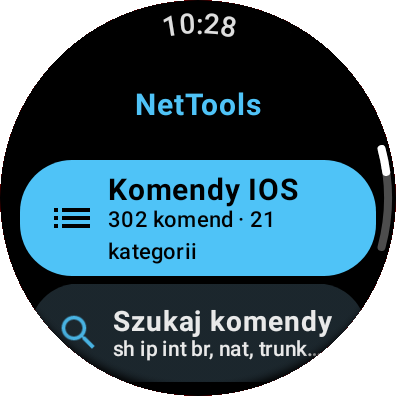 | 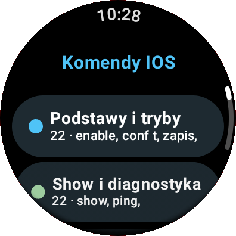 | 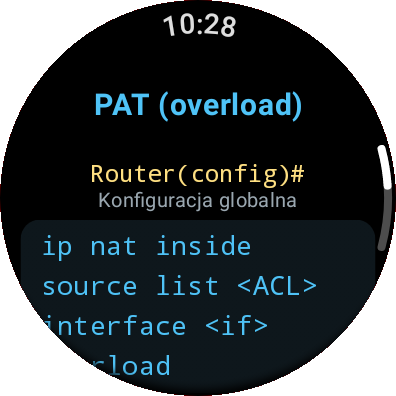 | 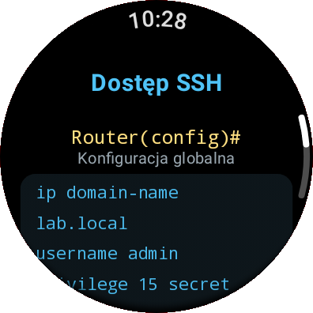 |
| **Szukanie skrótami** | **Generator** | **Ping** | **Skaner LAN** |
| 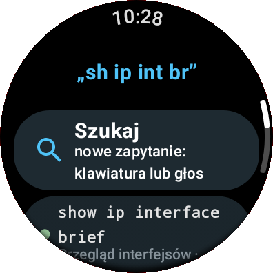 | 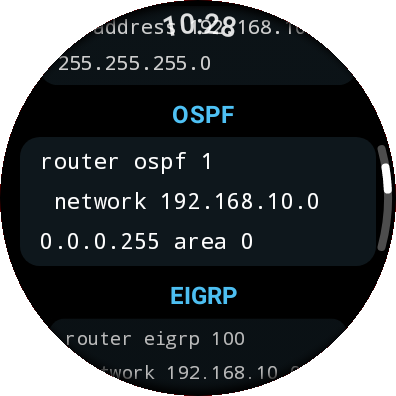 | 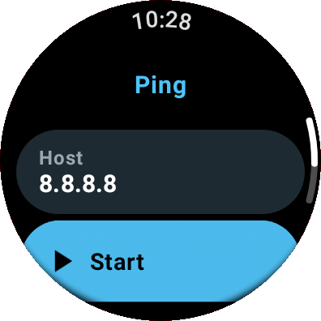 | 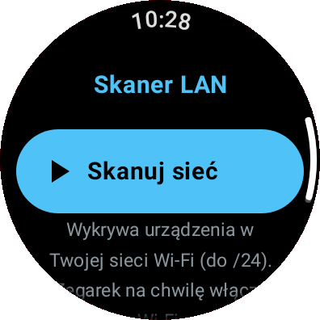 |

### Komendy Cisco IOS (offline)

Ponad 300 poleceń w 21 kategoriach: podstawy i tryby, show/diagnostyka, interfejsy, DHCP/DNS,
routing statyczny, OSPF, EIGRP, BGP, VLAN i trunk, routing między VLAN, STP, EtherChannel, ACL,
NAT/PAT, hasła i SSH, bezpieczeństwo L2 (port-security, DHCP snooping, DAI), HSRP/VRRP,
NTP/Syslog/SNMP/CDP/LLDP, IPv6, pliki i IOS oraz **gotowe konfiguracje** (SSH, router-on-a-stick,
SVI, DHCP, PAT, OSPF, bezpieczny port access, trunk, LACP, HSRP, odzyskiwanie hasła).

Każda komenda ma tryb (prompt, np. `(config-if)#`), opis po polsku, przykład i wskazówki.

- **Szukanie** klawiaturą lub głosem – rozumie skróty CLI (`sh ip int br`, `conf t`) i polskie opisy
  bez ogonków („trasa domyslna”).
- **Ulubione** – gwiazdka przy komendzie.
- **Generator komend** – wpisujesz sieć (np. `192.168.10.0/24`), dostajesz gotowe linie:
  `ip address`, OSPF/EIGRP z wildcard, ACL (z `host`/`any`), pulę DHCP, PAT, `ip route`, BGP, prefix-list.

### Narzędzia sieciowe

- **Moja sieć** – typ połączenia, SSID, sygnał, IP/maska, brama, DNS, IPv6, przełącznik **„Wymuś Wi-Fi”**.
- **Ping** – ICMP (systemowy ping z TTL) lub TCP (czas połączenia z portem), statystyki i wykres RTT.
- **Skaner portów** – popularne, sprzęt sieciowy (SSH, Telnet, SNMP, BGP, NETCONF…), WWW, 1–1024 lub jeden port.
- **DNS lookup** – rekordy A/AAAA i odwrotne PTR.
- **Skaner LAN** – wykrywa urządzenia w sieci Wi-Fi (do /24), pokazuje bramę, nazwy i otwarte porty;
  dotknięcie hosta → ping / porty / PTR.
- **Wake-on-LAN** – budzenie komputerów (MAC w każdym formacie, także Cisco `aabb.ccdd.eeff`).

> Zegarek połączony z telefonem korzysta z internetu telefonu (Bluetooth). Narzędzia LAN same
> włączają Wi-Fi i przypinają do niego aplikację; Wi-Fi musi być włączone w ustawieniach zegarka.

## CCNA

| Menu | Teoria (IPsec) | Fiszka | Quiz z wyjaśnieniem |
|---|---|---|---|
| 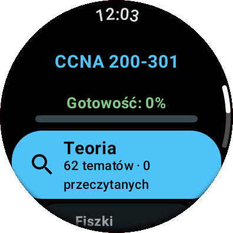 | 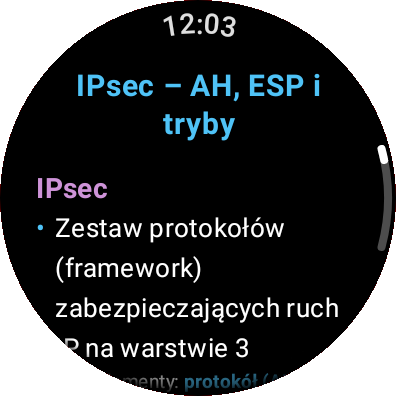 | 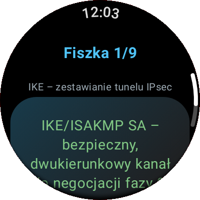 | 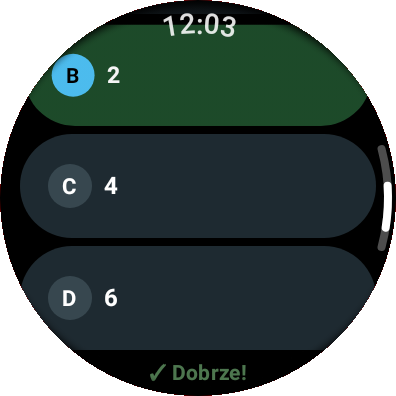 |
| **Egzamin próbny** | **Wynik** | **Przegląd błędów** | **Postęp** |
| 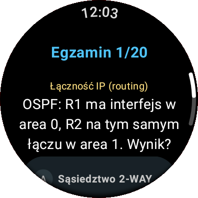 | 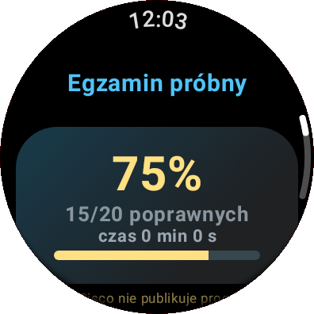 | 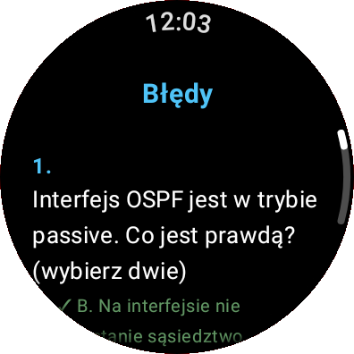 | 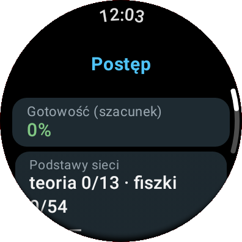 |

Materiał według programu **CCNA 200-301 v1.1**, po polsku, offline:

| Obszar | Waga | Zawartość |
|---|---|---|
| Podstawy sieci | 20% | OSI/TCP-IP, urządzenia, architektury (spine-leaf), WAN, chmura i wirtualizacja, kable, TCP/UDP, IPv4, IPv6, przełączanie, Wi-Fi |
| Dostęp do sieci | 20% | VLAN, trunk/DTP, routing między VLAN, CDP/LLDP, EtherChannel, STP/RSTP, architektury WLAN i tryby AP, zarządzanie |
| Łączność IP | 25% | tablica routingu, wybór trasy, routing statyczny, OSPFv2, DR/BDR, FHRP, zadania praktyczne |
| Usługi IP | 10% | NAT/PAT, NTP, DHCP/DNS, SNMP, Syslog, QoS, SSH/TFTP/FTP |
| Bezpieczeństwo i **VPN** | 15% | CIA, ataki, MFA, **kryptografia, rodzaje VPN, IPsec (AH/ESP, tryby), IKEv1/IKEv2, konfiguracja IPsec, GRE/VTI/DMVPN, SSL/TLS VPN, MPLS VPN i SD-WAN**, ACL, bezpieczeństwo L2, AAA/802.1X, WPA2/WPA3 |
| Automatyzacja | 10% | płaszczyzny i SDN, Catalyst Center, REST, JSON, Ansible/Puppet/Chef/Terraform, AI/ML |
| Ściągawki | – | porty, AD, timery, multicasty, maski, kody Syslog/DSCP/HTTP |

- **Teoria** – ponad 60 tematów z tabelami i przykładami poleceń; „oznacz jako przeczytane”.
- **Fiszki** – ponad 300, powtórki metodą Leitnera (najsłabiej znane najpierw).
- **Quiz** – ponad 240 pytań z wyjaśnieniami, także wielokrotnego wyboru; „Powtórz błędy”.
- **Egzamin próbny** – 20/40/60 pytań losowanych według wag obszarów, wynik per obszar i przegląd błędów.
- **Wyszukiwarka** – przeszukuje teorię, fiszki i pytania naraz (bez względu na polskie znaki), z podpowiedziami
  i historią (bez pisania), podświetla trafienia i otwiera temat od razu w pasującej sekcji.
- **Postęp i gotowość** – stan każdego obszaru i historia egzaminów.

Treść jest w zwykłych plikach tekstowych (`ccna/src/main/assets/ccna/*.txt`) – łatwo ją poprawiać i
rozszerzać; testy pilnują poprawności formatu (np. czy pytanie „wybierz dwie” ma dwie poprawne odpowiedzi).

> Aplikacja służy do nauki. Na egzaminie w centrum Pearson VUE zegarek trzeba zostawić w szafce.

## Budowanie

Wymagania: JDK 17+, Android SDK (platforma 35).

```bash
./gradlew :app:assembleRelease       # VLSM:     app/build/outputs/apk/release/app-release.apk
./gradlew :nettools:assembleRelease  # NetTools: nettools/build/outputs/apk/release/nettools-release.apk
./gradlew :ccna:assembleRelease      # CCNA:     ccna/build/outputs/apk/release/ccna-release.apk
./gradlew testDebugUnitTest          # testy logiki + renderowanie wszystkich ekranów (Robolectric)
```

Zrzuty ekranów z testów trafiają do `*/build/screenshots/`.

## Struktura

```
common/     # wspólne: logika IPv4 (Ip, Cidr, VLSM, FLSM, sumaryzacja), motyw, klawiatura IP, bezel
app/        # aplikacja VLSM: ekrany, zapis projektów
ccna/       # aplikacja CCNA: treść w assets/, parser, silnik nauki (Leitner, egzamin wg wag)
nettools/   # aplikacja NetTools
├── ios/    # baza komend Cisco IOS, wyszukiwarka skrótów, generator komend
├── net/    # sondy TCP, skaner, ping, MAC/Wake-on-LAN, wybór sieci Wi-Fi
└── ui/     # ekrany
```

Min. Wear OS 3 (API 30) – Galaxy Watch 4 i nowsze.
